# Báo cáo bài thực hành số 2 — Jenkins CI với Docker và GitHub

**Dự án:** Quản lý sinh viên (Node.js + Express)
**Repository:** `https://github.com/keithwalker69/quan-ly-sinh-vien`
**Phương án:** Triển khai Jenkins dưới dạng Docker Container

> Ảnh minh chứng nằm trong thư mục `docs/screenshots/`.

---

## 1. Giới thiệu dự án

Ứng dụng web quản lý sinh viên gồm:

- REST API (Express): thêm / sửa / xóa / tìm kiếm sinh viên, kiểm tra dữ liệu (mã SV dạng `SV0001`, email, GPA 0–4), tự xếp loại theo GPA, thống kê.
- Giao diện web HTML/JS gọi API.
- 11 test tự động: unit test cho logic nghiệp vụ (`test/students.test.js`) và integration test gọi API qua HTTP thật (`test/api.test.js`).

Cấu trúc thư mục:

```
quan-ly-sinh-vien/
├── src/            # students.js (logic), app.js (API), server.js
├── public/         # index.html (giao diện)
├── test/           # unit + integration test
├── jenkins/        # Dockerfile, plugins.txt, docker-compose.yml
├── Jenkinsfile     # định nghĩa pipeline
└── package.json
```

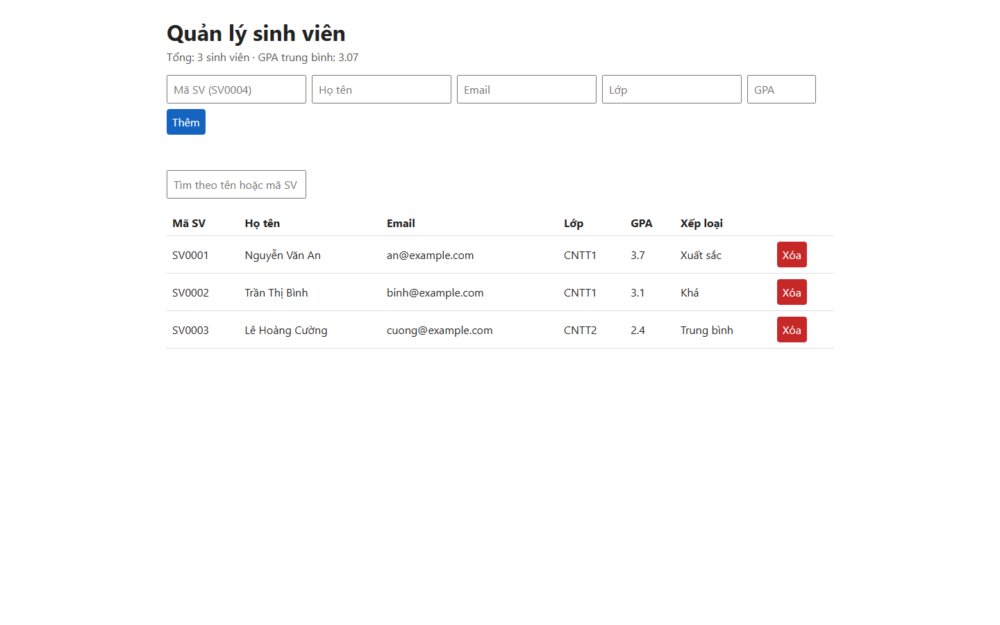
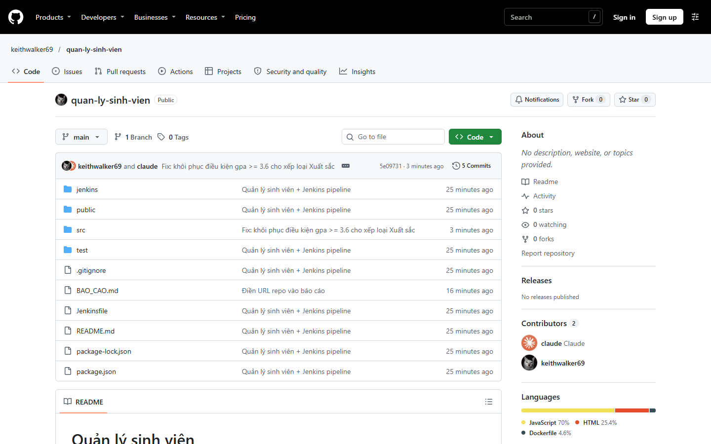

---

## 2. Thiết lập Jenkins dưới dạng Docker Container

Thay vì cài Jenkins trực tiếp, nhóm build một image riêng từ `jenkins/jenkins:lts-jdk21`, cài sẵn Node.js 24 và các plugin cần thiết (file `jenkins/Dockerfile`, `jenkins/plugins.txt`).

```bash
cd jenkins
docker compose up -d --build
```

Lấy mật khẩu admin lần đầu:

```bash
docker exec jenkins cat /var/jenkins_home/secrets/initialAdminPassword
```

Mở `http://localhost:8080` → dán mật khẩu → **Install suggested plugins** → tạo tài khoản admin.

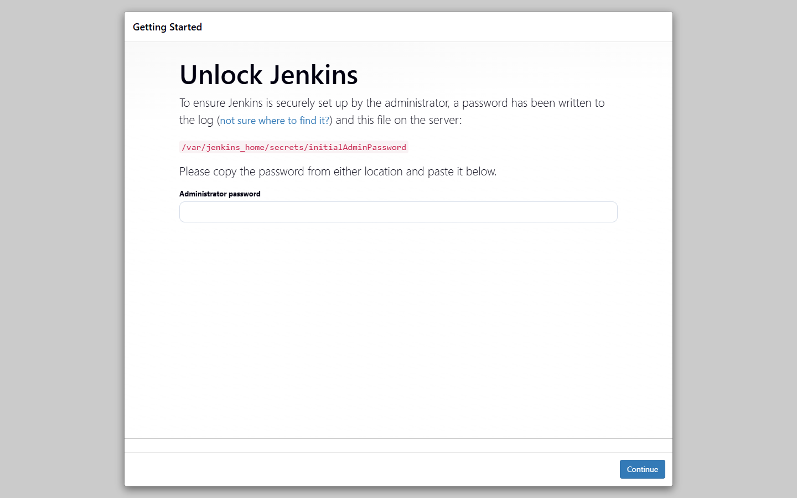
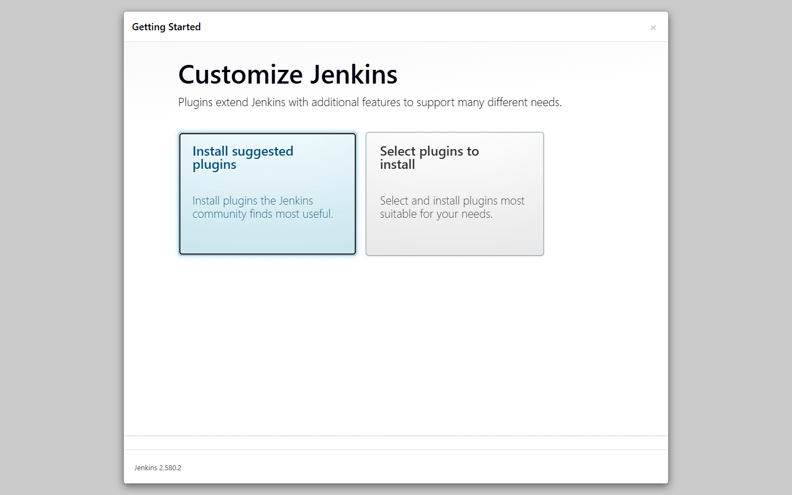
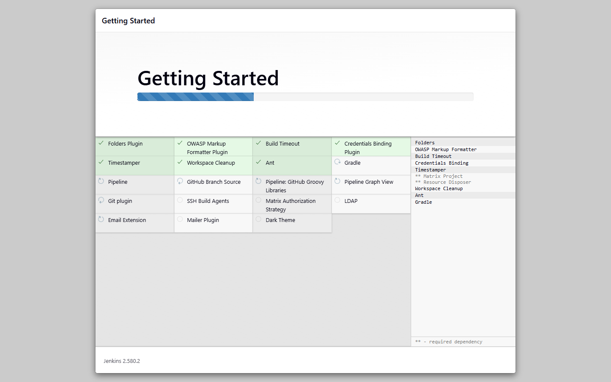
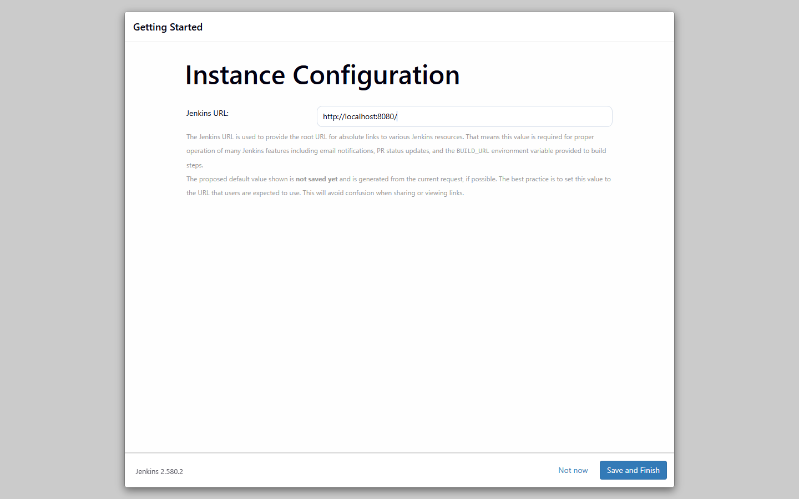
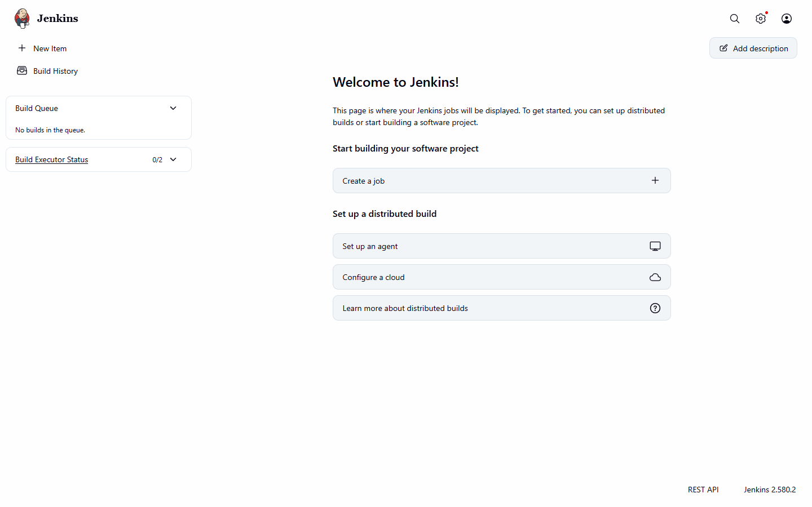

---

## 3. Cài đặt Plugins (bao gồm Testing Framework)

Các plugin đã cài sẵn qua `plugins.txt`:

| Plugin | Công dụng |
|---|---|
| Git, GitHub | Kết nối và lấy mã nguồn từ GitHub |
| Pipeline (workflow-aggregator) | Chạy pipeline từ Jenkinsfile |
| Pipeline: Stage View | Hiển thị các stage dạng bảng |
| **JUnit** | **Đọc kết quả test (file XML), vẽ biểu đồ test pass/fail** |
| Timestamper | Thêm thời gian vào log |

Kiểm tra: **Manage Jenkins → Plugins → Installed plugins**.

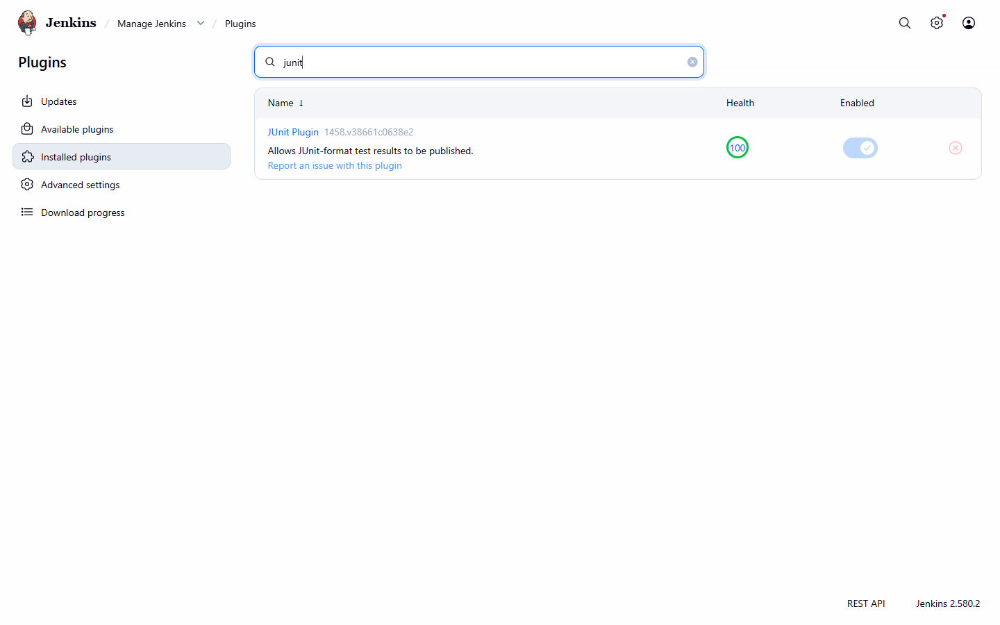
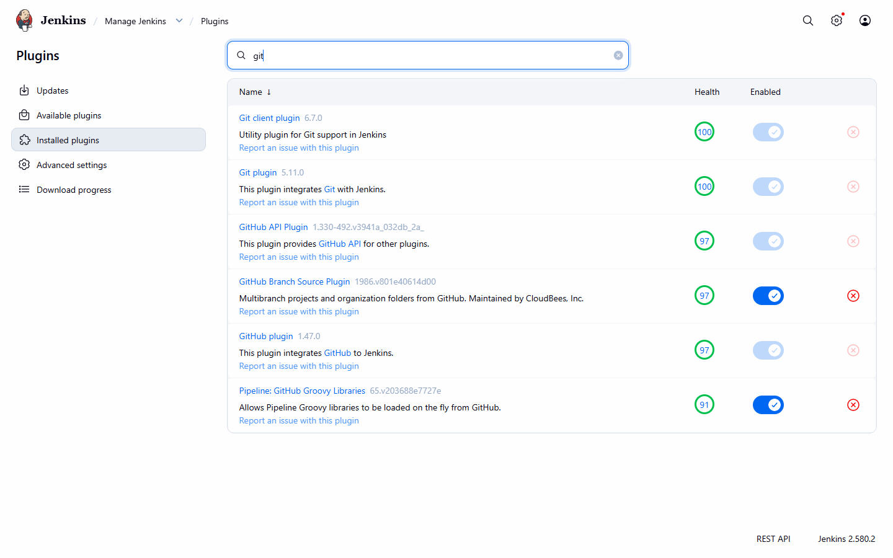
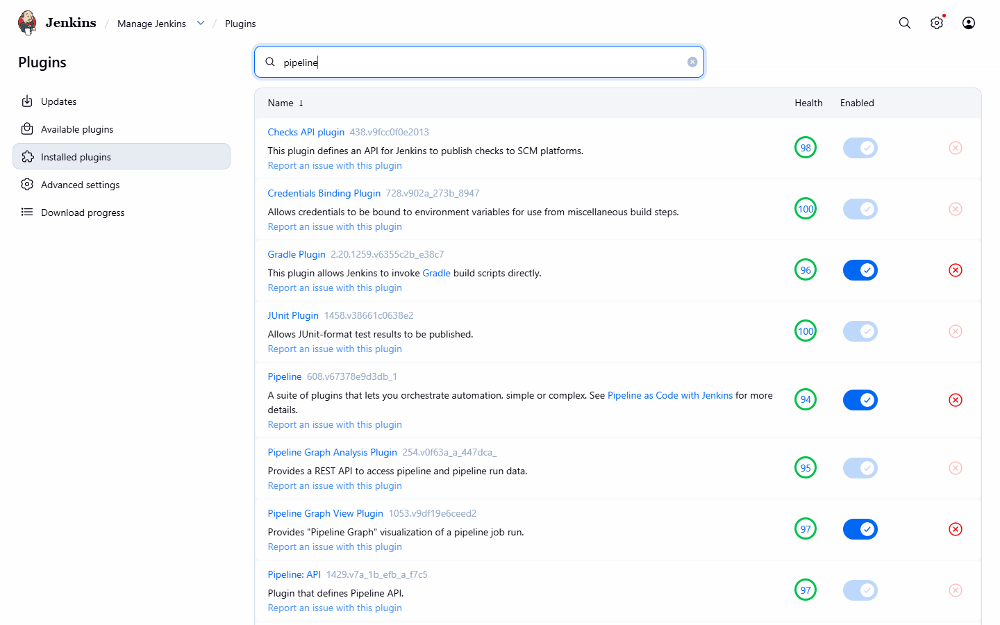

---

## 4. Tích hợp Jenkins với GitHub

1. Đẩy mã nguồn lên GitHub (repo public).
2. Trong Jenkins: **New Item** → tên `quan-ly-sinh-vien` → chọn **Pipeline** → OK.
3. Phần **Pipeline**:
   - Definition: **Pipeline script from SCM**
   - SCM: **Git**
   - Repository URL: `https://github.com/keithwalker69/quan-ly-sinh-vien.git`
   - Branch: `*/main`
   - Script Path: `Jenkinsfile`
4. **Save**.

> Nếu repo private: tạo Personal Access Token trên GitHub, thêm vào **Manage Jenkins → Credentials** dạng *Username with password*, rồi chọn credential đó ở bước 3.

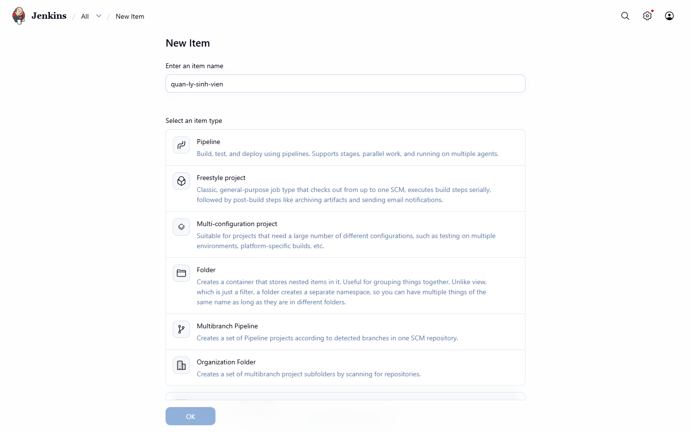
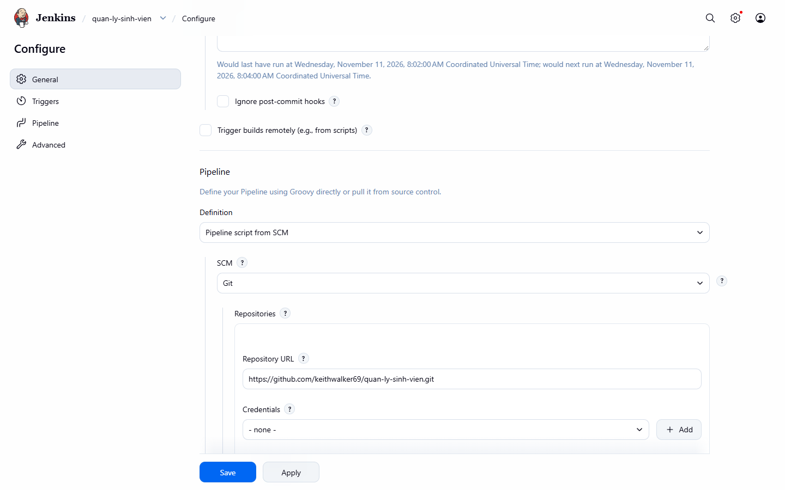

---

## 5. Tự động lấy mã nguồn từ Git Repository

Jenkinsfile khai báo:

```groovy
triggers {
    pollSCM('H/2 * * * *')
}
```

Jenkins tự kiểm tra GitHub khoảng mỗi 2 phút; khi có commit mới sẽ tự `checkout` và chạy pipeline. Nhóm dùng Poll SCM vì Jenkins chạy trên máy cá nhân, GitHub không gọi webhook vào được (không có IP public).

Lần đầu cần bấm **Build Now** một lần để Jenkins đọc Jenkinsfile và đăng ký trigger.

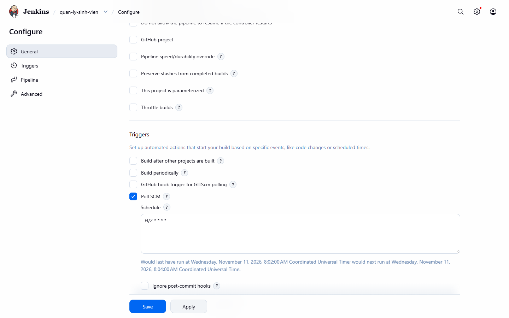
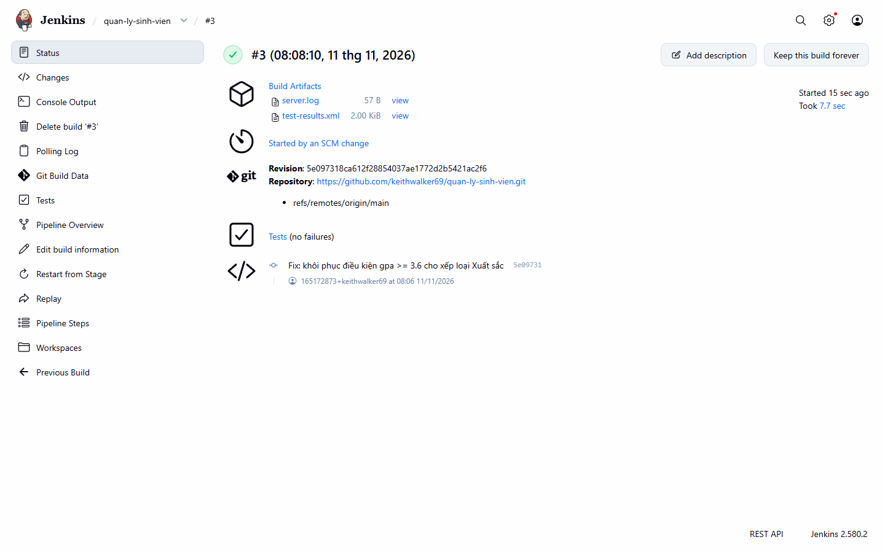

Build #2 và #3 đều ghi **Started by an SCM change**: Jenkins tự phát hiện commit mới, không ai bấm Build Now.

---

## 6. Xây dựng Jenkins Pipeline thông qua Jenkinsfile

Pipeline gồm các stage:

| Stage | Lệnh | Mục đích |
|---|---|---|
| Checkout | `checkout scm` | Lấy mã nguồn từ GitHub |
| Môi trường | `node --version` | Xác nhận Node.js có trong agent |
| Build | `npm ci`, `npm run lint` | Cài thư viện theo lock file, kiểm tra cú pháp |
| Test | `npm run test:ci` | Chạy 11 test, đo coverage, xuất `test-results.xml` |
| Smoke test | chạy server, `curl /api/health` | Kiểm tra app khởi động được |
| post | `junit`, `archiveArtifacts` | Hiển thị kết quả test, lưu file kết quả |

(Nội dung đầy đủ trong file `Jenkinsfile`.)

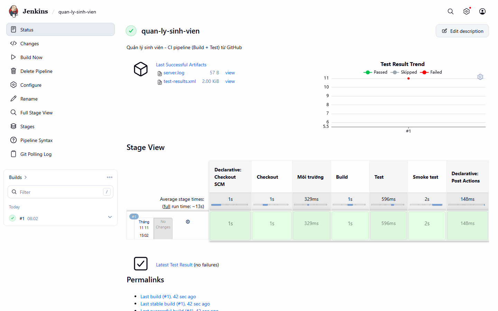

---

## 7. Tự động hóa Build và Test

- **Build:** `npm ci` cài đúng phiên bản thư viện trong `package-lock.json`; `npm run lint` kiểm tra cú pháp các file nguồn.
- **Test:** `node --test` chạy unit test và integration test. Reporter `junit` ghi file `test-results.xml`, plugin JUnit đọc file này và hiển thị **Test Result** + biểu đồ **Test Result Trend** qua các lần build. Coverage được in ra trong Console Output (≈ 99% dòng code).

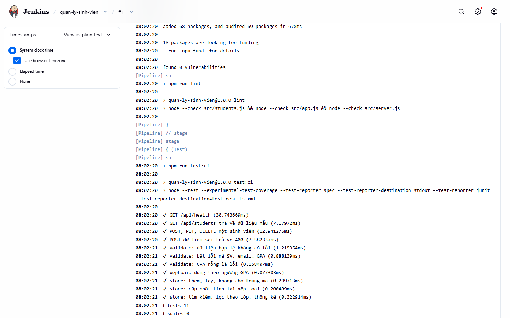
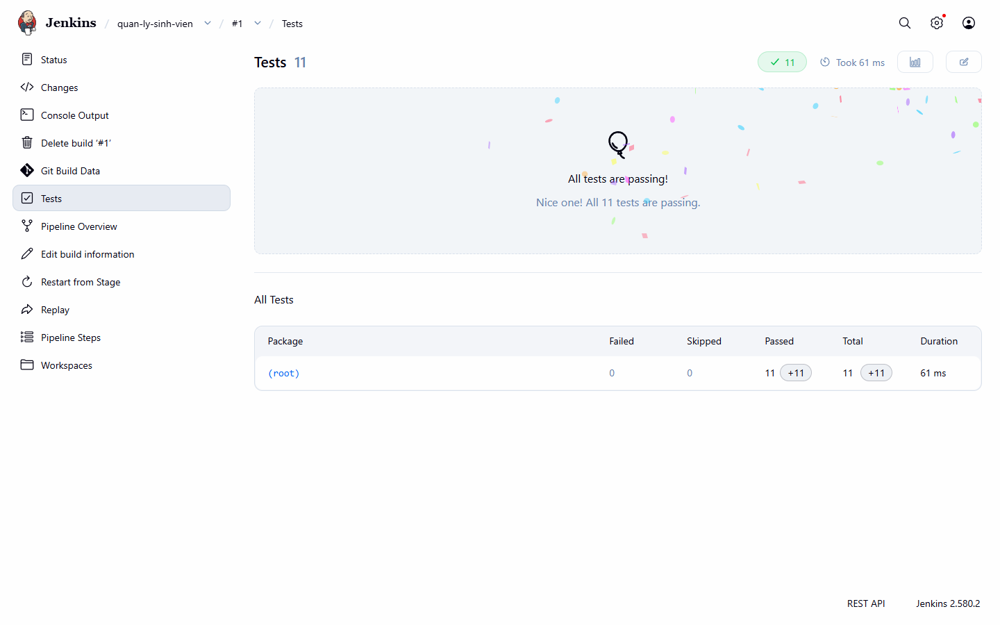

---

## 8. Phân tích kết quả và xử lý lỗi phát sinh

### 8.1 Kết quả build thành công

- Build #1 (bấm Build Now lần đầu): **SUCCESS**, tất cả stage đạt.
- 11/11 test pass; coverage ≈ 99% dòng, ≈ 87% nhánh.
- Thời gian chạy: khoảng 13 giây.

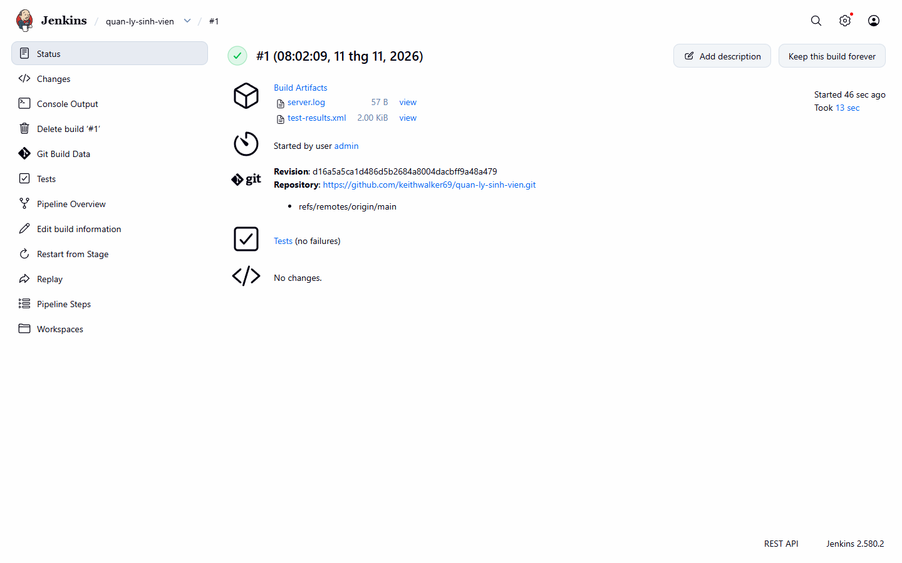

### 8.2 Lỗi cố ý: test thất bại

Để kiểm tra Jenkins phát hiện lỗi, nhóm sửa ngưỡng xếp loại trong `src/students.js`:

```js
if (gpa > 3.6) return 'Xuất sắc';   // bản lỗi: đổi >= thành >
```

Với GPA đúng 3.6, hàm trả về `Giỏi` thay vì `Xuất sắc`.

> Lần thử đầu nhóm đổi `3.6` thành `3.5` nhưng không test nào bắt được (test không có GPA nằm giữa 3.5 và 3.6). Bài học: test chỉ bắt được lỗi ở những giá trị nó kiểm tra, nên cần test đúng các giá trị biên.

**Build #2** (commit `2b143cc`, Started by an SCM change): stage **Test** đỏ, build **FAILURE**. Console Output và trang Test Result chỉ rõ test `xepLoai: đúng theo ngưỡng GPA` lỗi: mong đợi `'Xuất sắc'`, thực tế `'Giỏi'`.

**Xử lý:** đọc thông báo lỗi → mở `src/students.js` → sửa lại `>= 3.6` → push (commit `5e09731`).

**Build #3** (Started by an SCM change): **SUCCESS**, 11/11 test pass, biểu đồ Test Result Trend thể hiện build #2 đỏ rồi xanh lại.

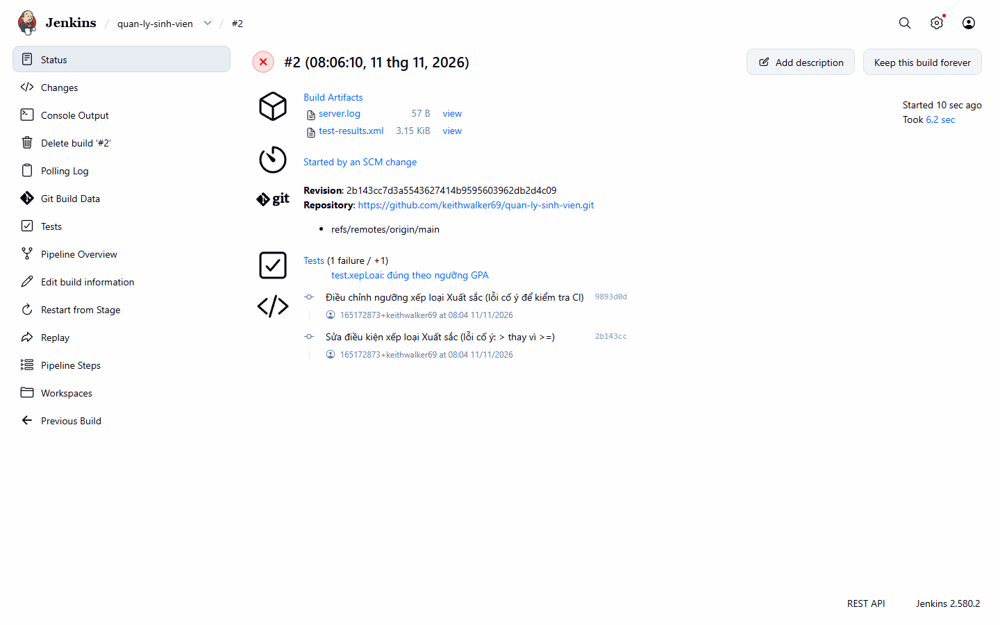
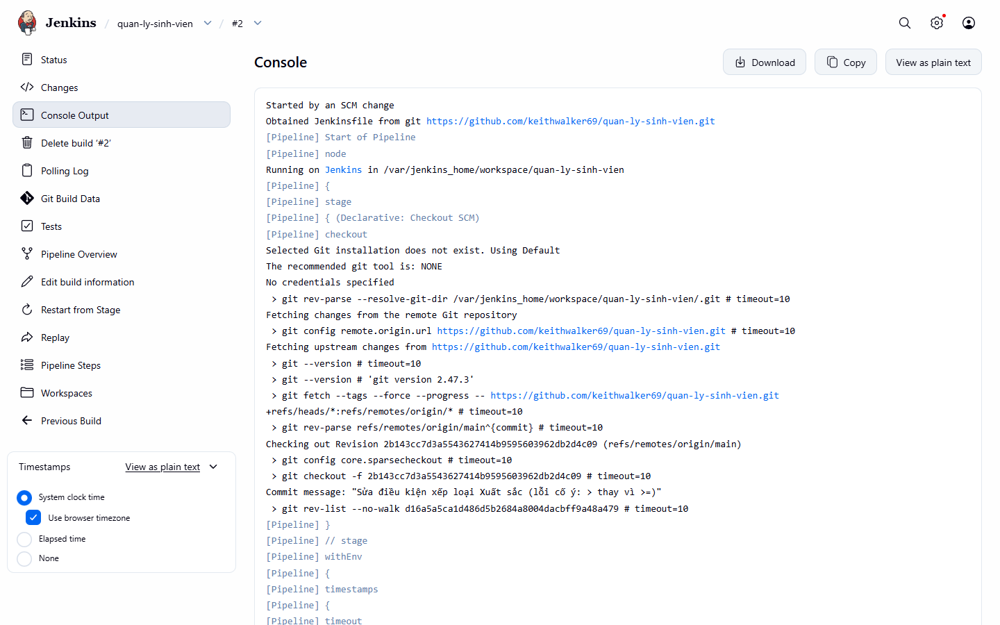
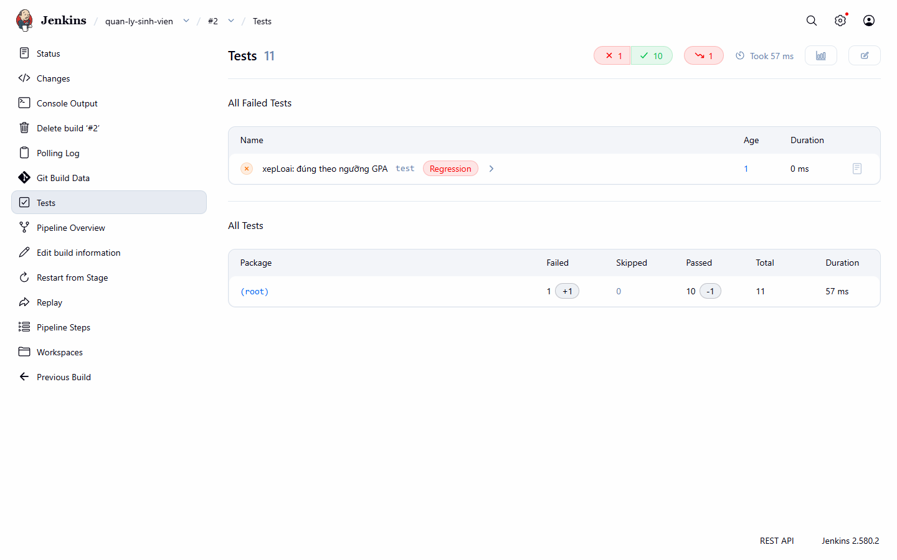
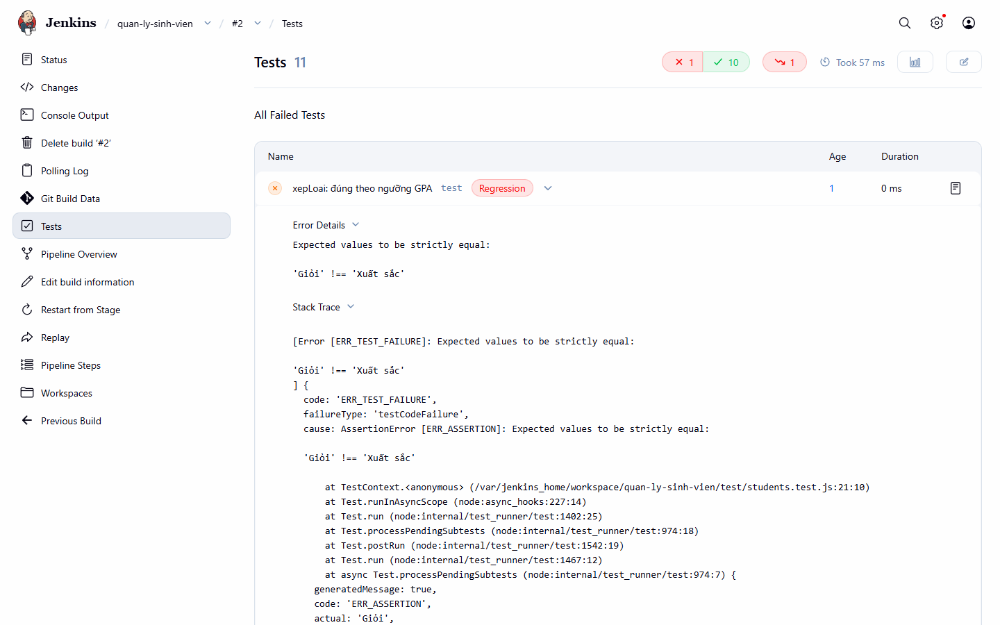
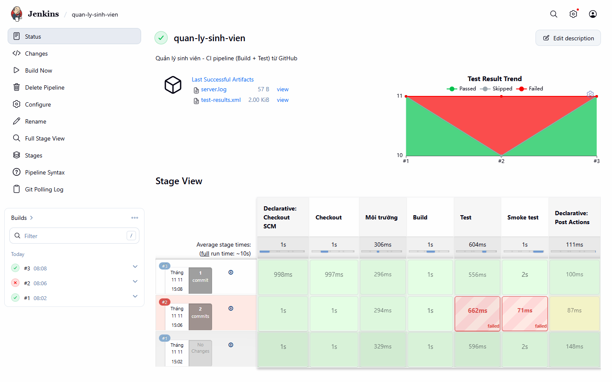
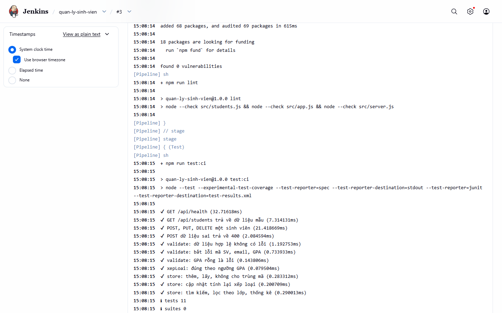
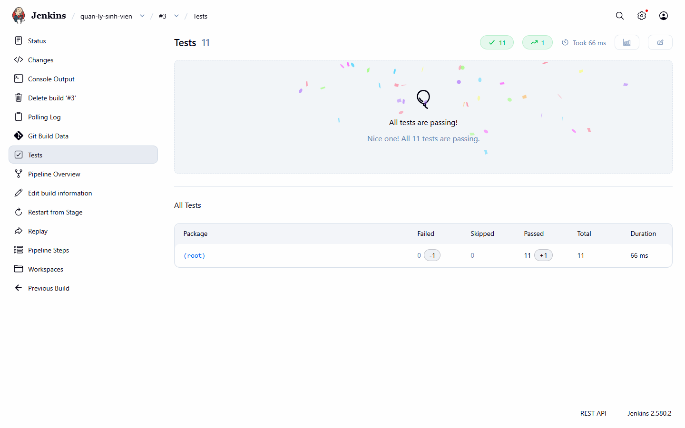

### 8.3 Các lỗi thường gặp khi thiết lập và cách xử lý

| Lỗi | Nguyên nhân | Cách xử lý |
|---|---|---|
| `npm: not found` | Image Jenkins gốc không có Node.js | Build image riêng có Node.js (`jenkins/Dockerfile`) hoặc dùng NodeJS plugin |
| `Couldn't find any revision to build` | Sai tên nhánh (`master` thay vì `main`) | Sửa Branch Specifier thành `*/main` |
| `Authentication failed` / `repository not found` | Repo private chưa có credential | Thêm GitHub token vào Credentials |
| `No test report files were found` | Test lỗi trước khi ghi file XML | Xem Console Output; `allowEmptyResults: true` để không che lỗi gốc |
| `npm ci` lỗi thiếu lock file | Chưa commit `package-lock.json` | Commit `package-lock.json` lên repo |
| `EADDRINUSE` ở smoke test | Cổng đã bị chiếm | Dùng cổng riêng (`PORT=3100`) |
| Pipeline không tự chạy | Chưa build lần đầu nên trigger chưa đăng ký | Bấm Build Now một lần |

---

## 9. Kết luận

Nhóm đã triển khai Jenkins bằng Docker, kết nối GitHub, cài plugin JUnit cho testing, xây dựng pipeline bằng Jenkinsfile để tự động lấy mã nguồn, build, test và báo cáo kết quả. Mỗi khi có commit mới, Jenkins tự kiểm tra và báo ngay commit nào làm hỏng test.
