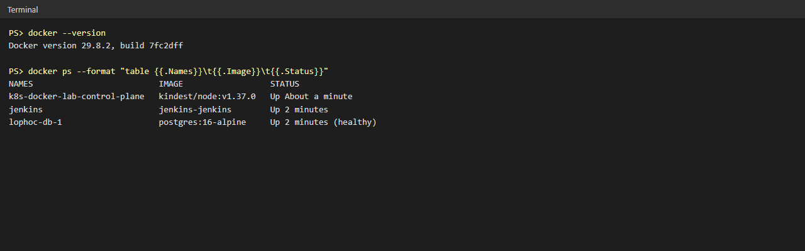
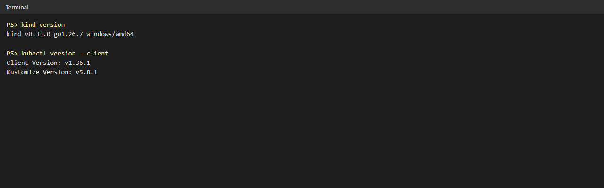
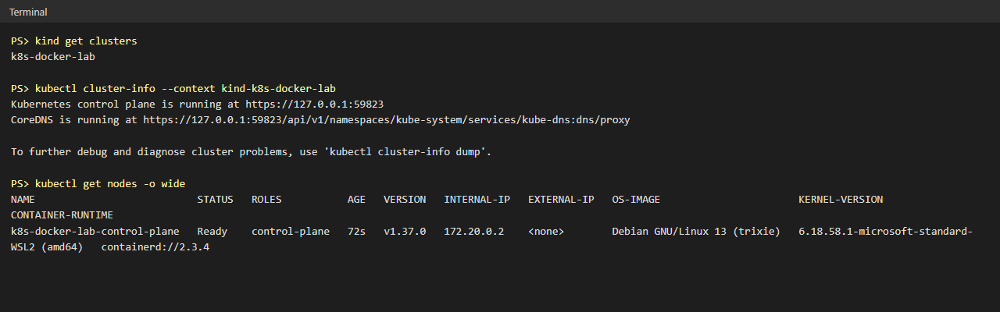
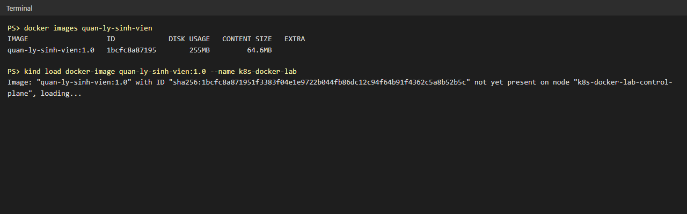
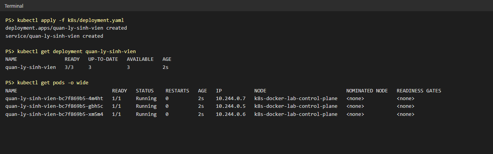
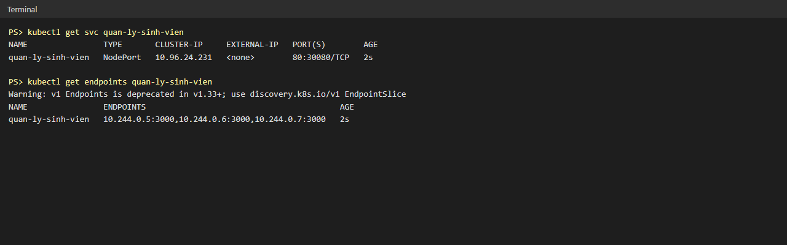
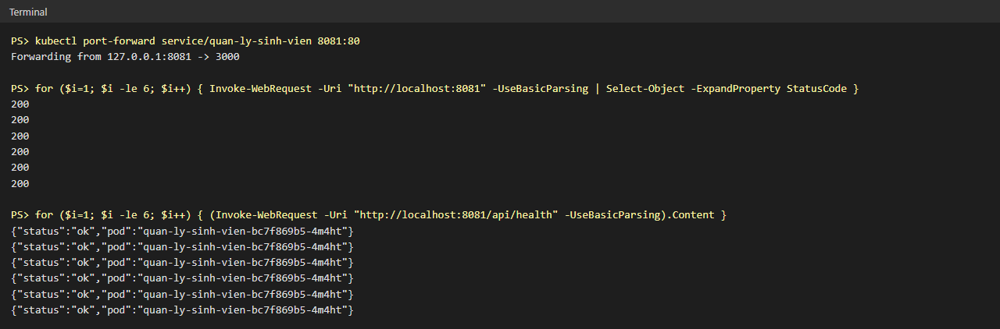
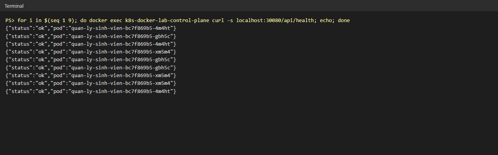
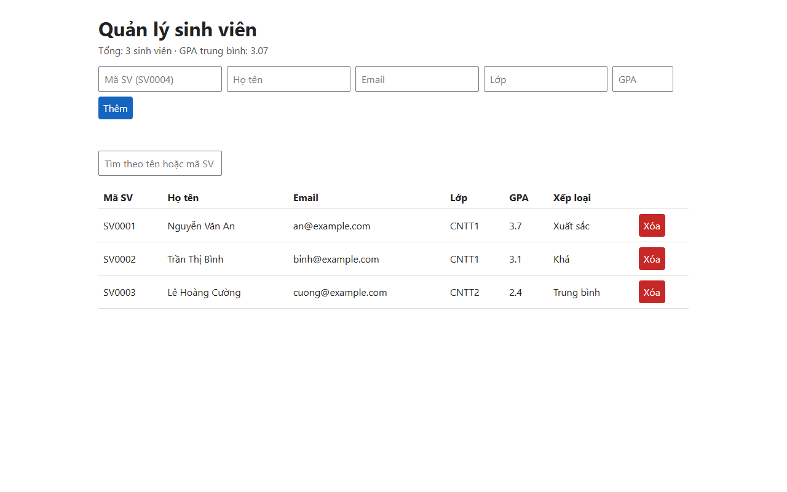
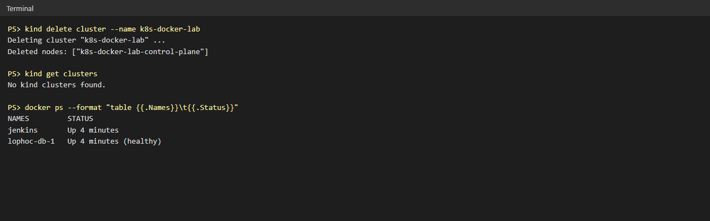

# Báo cáo thực hành Kubernetes (K8s) trên nền Docker — Single Node, Windows

**Ứng dụng triển khai:** Quản lý sinh viên (Node.js + Express) — repo `https://github.com/keithwalker69/quan-ly-sinh-vien`
**Công cụ:** Docker Desktop, kind v0.33.0 (Kubernetes trong Docker), kubectl

Thay vì dùng image `nginx:alpine` như đề bài mẫu, nhóm triển khai chính ứng dụng Quản lý sinh viên. API `/api/health` trả về tên Pod đang xử lý request, nhờ đó **nhìn thấy trực tiếp** Kubernetes chia tải cho Pod nào.

Các file thêm vào repo:

| File | Nội dung |
|---|---|
| `Dockerfile` | Đóng gói ứng dụng thành image `quan-ly-sinh-vien:1.0` (node:24-alpine) |
| `k8s/deployment.yaml` | Deployment 3 replicas + Service NodePort (cổng 80 → 3000, nodePort 30080) |
| `src/app.js` | `/api/health` trả thêm `pod` = hostname của Pod |

---

## PHẦN 1: Chuẩn bị môi trường K8s trên Docker

### Bước 1: Kiểm tra Docker

```powershell
docker --version
docker ps
```



### Bước 2: Cài kind và kubectl

```powershell
winget install Kubernetes.kind
winget install Kubernetes.kubectl   # Docker Desktop đã có sẵn kubectl
```



### Bước 3: Khởi tạo cụm Single-Node

```powershell
kind create cluster --name k8s-docker-lab
```

### Bước 4: Kiểm tra kết nối

```powershell
kubectl cluster-info --context kind-k8s-docker-lab
kubectl get nodes
```



Node `k8s-docker-lab-control-plane` ở trạng thái **Ready** — thực chất là một container Docker chạy toàn bộ Kubernetes.

---

## PHẦN 2: Bài thực hành 1 — Triển khai ứng dụng và kiểm tra cân bằng tải

### Bước 0: Build image và nạp vào cụm

Cụm kind không đọc được image trên máy, nên phải nạp image vào node:

```powershell
docker build -t quan-ly-sinh-vien:1.0 .
kind load docker-image quan-ly-sinh-vien:1.0 --name k8s-docker-lab
```



### Bước 1: Tạo Deployment với 3 Pod

Tương đương `kubectl create deployment ... --replicas=3`, nhưng khai báo bằng file YAML để lưu trong repo:

```powershell
kubectl apply -f k8s/deployment.yaml
kubectl get pods -o wide
```



3 Pod `Running`, mỗi Pod một IP riêng (10.244.0.5 / .6 / .7).

### Bước 2: Tạo Service NodePort

Service gom 3 Pod lại sau một địa chỉ chung (tương đương `kubectl expose deployment ... --type=NodePort --port=80`):

```powershell
kubectl get svc quan-ly-sinh-vien
kubectl get endpoints quan-ly-sinh-vien
```



Endpoints liệt kê đủ 3 IP Pod — Service sẽ chia request cho cả 3.

### Bước 3: Kiểm tra cân bằng tải

**a) Theo đề bài — port-forward + vòng lặp PowerShell** (dùng cổng 8081 vì 8080 đang chạy Jenkins):

```powershell
kubectl port-forward service/quan-ly-sinh-vien 8081:80
for ($i=1; $i -le 6; $i++) { Invoke-WebRequest -Uri "http://localhost:8081" -UseBasicParsing | Select-Object -ExpandProperty StatusCode }
```



Cả 6 request trả về **200**. Tuy nhiên khi gọi `/api/health`, **cả 6 request đều vào cùng 1 Pod**.

> **Nhận xét:** `kubectl port-forward service/...` chỉ chọn **một** Pod của Service rồi giữ kết nối tới Pod đó, nên không thể hiện cân bằng tải. Đây là công cụ debug, không đi qua cơ chế chia tải của Service.

**b) Kiểm tra đúng — gửi request qua NodePort của Service:**

```powershell
for i in 1..9: docker exec k8s-docker-lab-control-plane curl -s localhost:30080/api/health
```



9 request được chia cho **cả 3 Pod** (`4m4ht`, `gbh5c`, `xm5m4`) → Service (kube-proxy) tự động phân phối lưu lượng, không dồn vào một Pod.

Giao diện ứng dụng chạy trong Kubernetes (qua `http://localhost:8081`):



---

## PHẦN 3: Bài thực hành 2 — Dọn dẹp hệ thống

```powershell
kind delete cluster --name k8s-docker-lab
```



Cụm đã bị xóa; các container khác (Jenkins) không bị ảnh hưởng.

---

## Kết luận

- Dựng được cụm Kubernetes một node chạy bên trong Docker trên Windows bằng kind.
- Đóng gói ứng dụng Quản lý sinh viên thành image và triển khai 3 bản sao bằng Deployment.
- Service NodePort chia đều request cho 3 Pod — chứng minh bằng tên Pod trả về trong từng response.
- Phát hiện `kubectl port-forward` chỉ đi vào một Pod nên không dùng để chứng minh cân bằng tải được.
- Dọn dẹp toàn bộ cụm bằng một lệnh.

**Chạy lại từ đầu:**

```powershell
kind create cluster --name k8s-docker-lab
docker build -t quan-ly-sinh-vien:1.0 .
kind load docker-image quan-ly-sinh-vien:1.0 --name k8s-docker-lab
kubectl apply -f k8s/deployment.yaml
```
